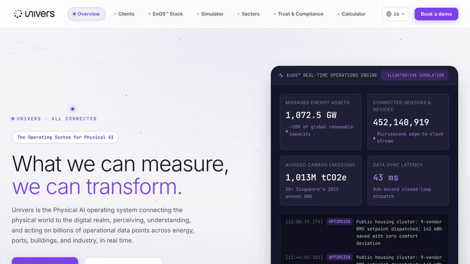

# Univers: All Connected (concept redesign)

An unofficial concept redesign of the [Univers](https://univers.com/) website: a 9-page, 7-language, framework-free site for a deep-tech brand that sits between heavy operational technology (energy grids, ports, smart buildings) and cloud intelligence. **Top 5 of 100 entries, pitched live to the CEO.**

**Live:** <https://univers-homepage-revamp.vercel.app/>



## Things to try

- **Interactive WebGL mesh.** A Three.js scene of connected endpoints with depth, per-node glow and camera parallax. Nodes drift, link up and spring away from your cursor.
- **Electric drag trail.** Click and drag anywhere to leave a neon ribbon with physics-driven sparks.
- **Odometer counters.** Each digit of a statistic scrolls like a mechanical ticker. Hover or click to re-roll.
- **3D card tilt** with a specular flashlight that follows the pointer.
- **Interactive Lab** (bottom-right button): a grid stress test that spikes the telemetry and resolves in 11 ms, a procedural sound engine built on the Web Audio API with no audio files, and background modes (OT Mesh, Grid Matrix, Solar Drift).

## How it's built

No React, no Tailwind, no build step, no `node_modules`.

| Layer | Approach |
| --- | --- |
| Markup and style | Semantic HTML5, vanilla CSS with design tokens and responsive grid |
| Behaviour | Vanilla JS modules: physics interpolation, cursor tracking, a custom i18n engine for 7 languages, Web Audio |
| 3D | Three.js loaded with a single dynamic `import()` from a CDN. Drop it and the site still runs, minus the background |
| Brand | Real Univers palette (UN-Nebula `#7A42EA`, navy `#14142B`, `#F5F5F7`), Inter with tabular figures, JetBrains Mono for telemetry |

Skipping a framework keeps first paint instant and means nothing to install or build.

## Run it

```bash
git clone https://github.com/evanyap7/univers-homepage-revamp.git
cd univers-homepage-revamp
python3 -m http.server 8080      # or: npx serve .
```

Deployed as static hosting on Vercel; `vercel.json` sets clean URLs and cache headers.

## Disclaimer

Unofficial concept and portfolio work based on univers.com and its public brand guidelines. Not affiliated with or endorsed by Univers. All trademarks belong to their owners.

Built by **Evan Yap** · [LinkedIn](https://www.linkedin.com/in/evanyapzhikai/)
